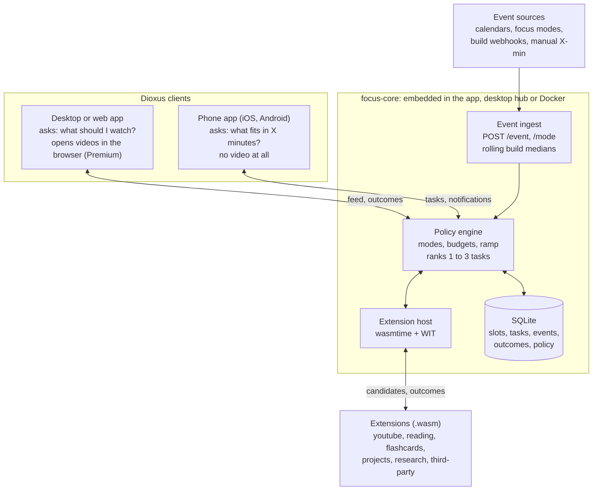
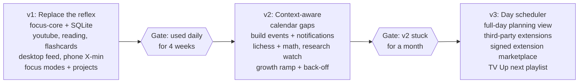

# Focus Engine: Design Doc

This is the reference design. When implementation departs from it, update this file in the same commit.

## Problem and goals

Focus Engine replaces the YouTube Shorts reflex with a curated feed on the computer and a "what fits in X minutes?" tool on the phone, then grows into a day scheduler that slowly shifts time toward mind-growing tasks.

The problem is not YouTube itself but its defaults: Shorts, autoplay and an engagement-optimized home feed. The habit of opening it is real, so the system intercepts that habit instead of fighting it.

**Goals**

1. Follow chosen channels for new long-form uploads, with zero Shorts, keeping YouTube Premium (no ads).
2. Suggest relevant new videos and worthwhile rewatches from watch history.
3. On the phone, offer short productive tasks sized to the time available, with no video at all.
4. Adapt suggestions to context: time of day, focus mode, calendar gaps, work build events.
5. Gradually raise the share of learning and mind-game tasks without making it feel like homework.
6. Let anyone add task sources as sandboxed WASM extensions tagged by category.

## Principles and non-goals

**Principles**

- **Replace a reflex, don't add a chore.** Every screen must replace something the user already opens. Queue maintenance must stay near zero.
- **Extensions propose, the policy decides.** Ranking, ratios and budgets belong to the user, never to a task source.
- **Nudge, never lock.** Growth content ramps slowly and backs off when skipped. Leisure stays in the mix.
- **Measure what matters.** The success signal is a weekly "was this week well spent?" rating, not tasks completed.
- **Private by default.** Personal and work data never leave the user's own devices or server.
- **Built for anyone, not just its author.** Every feature is designed for a non-technical user first: install like any app on macOS, Windows, Linux, iOS or Android, no server, no API keys, no terminal. Power-user options (Docker, Tailscale, local LLMs, Elicit, CI webhooks) are opt-in layers on top, never prerequisites. A feature that only works for a developer is incomplete.

**Non-goals**

- A YouTube client or player. Playback stays in the official YouTube app or the user's browser.
- Blocking or enforcement. The OS (Screen Time, Digital Wellbeing) does that; Focus Engine makes the good path easy.
- A full task manager. It reads calendars and reminders; it does not replace them.
- Social features or engagement metrics of any kind.

## Architecture

One Rust engine holds all state and logic; the desktop, mobile and web apps are thin Dioxus clients that only ask "what now?" and report outcomes.



Events set the context, extensions supply candidates, and the policy engine alone decides what each client shows.

- **Engine:** Rust, Tokio, axum for the HTTP API (hub and server modes), SQLite via rusqlite (bundled), wasmtime for extensions. In hub or server mode it runs continuously, so polling never happens on the phone. In solo mode on iOS, it refreshes when the app opens and in short background windows.
- **Clients:** one Dioxus codebase for macOS, Windows, Linux, iOS, Android and the web. Screens in v1: desktop feed (New, Suggested, Rewatch) and phone "I have 2 / 5 / 15 min".
- **API:** `GET /next?minutes=&device=`, `POST /outcome`, `POST /event`, `POST /mode`. JSON over HTTP (local network, or Tailscale/reverse proxy), device tokens for auth.
- **Shared types:** a `focus-types` crate used by engine and clients, kept in sync with the WIT types.

**Install modes.** The engine is a library crate (`focus-core`), so the same engine runs embedded in the app or as a server. Users pick a mode in onboarding and can switch later; data migrates as one SQLite file.

| Mode | For whom | How it runs | Phone access |
| --- | --- | --- | --- |
| Solo | Anyone, default | `focus-core` embedded in the app on one device, local SQLite | Only that device |
| Desktop as hub | Computer + phone users, no server | Embedded in the desktop app on any OS, which also serves the API while open (menu bar or tray icon keeps it running) | Pair by QR code over the local network; Tailscale optional for away-from-home |
| Server | Power users, families | Docker image + docker compose with ntfy, on any Docker host | From anywhere, via Tailscale or a reverse proxy |

Hub and server modes also serve the Dioxus web build, so any browser on any device (a work PC, a Chromebook, a tablet) is a client with nothing to install.

**Zero-config defaults.** Works with no keys at all: YouTube via RSS, arXiv and OpenAlex without accounts, no LLM (summaries and quizzes simply hidden). Each optional key unlocks a feature and is added through a guided screen, never a config file.

**Distribution.** macOS: signed DMG and Homebrew cask. Windows: signed MSI and winget. Linux: AppImage and Flatpak. iOS: TestFlight, then App Store. Android: APK on GitHub, F-Droid, then Play Store. Web: bundled in hub and server modes. Server: Docker image on GitHub Container Registry. CI builds all targets from one tag.

## Core data model

Everything reduces to six entities: events open slots, extensions fill queues with tasks, the policy fills slots from queues, and outcomes feed back. YouTube is just one queue type.

| Entity | Key fields | Notes |
| --- | --- | --- |
| Slot | start, end or minutes, device, mode, origin | Known ahead (calendar gap, evening) or ad hoc ("I have 5 min", build started) |
| Queue | id, extension, category, tags, weight | One per source: YouTube channels, Zotero papers, Lichess, flashcards |
| Task | id, queue, title, category, est_minutes, difficulty, device, content blocks, expires_at | Candidates returned by extensions; cached, never trusted for ranking |
| Policy | mode, rules, budgets, target ratios, ramp state | Versioned rules table per mode, editable by the user |
| Event | source, kind, start, end, metadata | Generic ingest: calendar, focus mode, builds, manual |
| Outcome | task, slot, verdict (done, skipped, partial, not interested), score, duration | Drives difficulty, ramp back-off and rewatch scoring |

**Categories:** a small core set the policy understands (`leisure`, `learning`, `mind-game`, `production`, `chores`, `rest`) plus free-form tags. Users map tags to categories, so new extensions never break the ratio logic.

**Storage:** SQLite (WAL mode), one file, easy to back up. Content blocks stored as JSON. Notes are plain Markdown files next to it.

Current tables: `tasks` is the engine's cache of each source's candidates (the full task as JSON, plus source order and `expires_at`), rewritten after every refresh or change of followed channels, so the feed is one query and a task leaves on time without a refresh. `outcomes` is an append-only log; undo sets `undone_at` instead of deleting, so history is kept for skip rates and rewatch scoring. `source_kv` holds each source's private key-value data (the WIT `kv-*` functions); the YouTube source keeps one key per channel, follow flag and video, and converts its earlier whole-list layout on start. `projects` and `settings` hold the rest.

## Policy engine

The policy turns (slot, mode, history) into a short ranked list of 1 to 3 tasks. It is data, not code: a rules table per mode that the user edits.

**Modes.** Set by OS focus-mode events, with a schedule as fallback. Starting set:

| Mode | Allowed categories | Video | Example rule |
| --- | --- | --- | --- |
| work | learning, production, rest | Work-tagged only, max 1 per day | During a build slot, fit tasks to the build's expected duration |
| evening | all | Full feed | Leisure allowed, growth share follows the ramp |
| late | rest, leisure | One rewatch at most | Otherwise suggest going to bed |
| phone (any mode) | learning, mind-game, production, chores | Never | Text summaries of long videos instead |

**Budgets.** Daily minutes per category. Video starts at 60 min on work days and 120 on weekends. Each hand-off logs the video's duration as a proxy for watch time. When a budget is spent, that category disappears until the next day.

In the prototype only the video budget exists. A hand-off is charged to the local date on which it happened; marking a video "watched" without opening it charges nothing; undo refunds the original day. When the budget is spent, the feed shows a calm "see you tomorrow" state with the project notes and a small "show the feed anyway" link (nudge, never lock).

**Growth ramp.** A target share of `learning` + `mind-game` + `production` per mode, raised by a few points per week (for example 20%, 25%, 30%), capped by the user.

**Back-off.** If the skip rate on growth tasks over the last 7 days rises above a threshold, the ramp pauses; if it keeps rising, it steps back. In effect a small bandit tuning itself to what the user actually does.

**Difficulty.** Per-skill Elo-style ratings (chess, math, a language, a Rust track). Tasks are chosen slightly above the current rating.

**Ranking.** Score = fit to slot length + category quota gap + momentum (resume what was started) + novelty rotation - recent skips. Ties broken by queue weight.

## Extension system

Task sources are WebAssembly components run by wasmtime inside the engine. They propose candidates; they never rank, never see personal data and never render their own UI.

**Interface (WIT, draft)**

```wit
package focus:engine@0.1.0;

interface types {
  enum category { leisure, learning, mind-game, production, chores, rest }
  enum device { desktop, phone, any }
  enum verdict { done, skipped, partial, not-interested }

  variant block {
    text(string),
    heading(string),
    link-out(string),          // opens in the default browser or a native app
    quiz(quiz),
    timer(u32),                // seconds
    code-exercise(code-exercise),
    image(string),             // URL on an allowed domain
  }

  record quiz { prompt: string, choices: list<string>, answer: option<u32> }
  record code-exercise { language: string, prompt: string, starter: string }

  record ctx {
    minutes: u32,
    device: device,
    mode: string,
    skill-ratings: list<tuple<string, f32>>,
    locale: string,
  }

  record task {
    id: string,
    title: string,
    category: category,
    tags: list<string>,
    est-minutes: u32,          // 0 = unknown, the host applies its default
    difficulty: option<f32>,
    device: device,
    content: list<block>,
    expires-at: option<u64>,
  }

  record outcome { task-id: string, verdict: verdict, score: option<f32>, minutes: u32 }

  record manifest {
    name: string,
    version: string,
    categories: list<category>,
    allowed-hosts: list<string>,
    wants-llm: bool,
  }

  // Redirects are never followed, so a source can tell a 200 from a 3xx
  // (the YouTube Shorts check depends on it).
  record http-response { status: u16, location: option<string>, body: list<u8> }
}

interface host {
  use types.{http-response};
  // no personal data crosses this boundary
  http-get: func(url: string) -> result<http-response, string>;  // allowlisted hosts only
  // A private store per extension. Names follow wasi:keyvalue where they
  // overlap; listing takes a prefix so an extension can keep one key per item.
  kv-get: func(key: string) -> option<list<u8>>;
  kv-set: func(key: string, value: list<u8>);
  kv-delete: func(key: string);
  kv-list: func(prefix: string) -> list<string>;                    // sorted
  kv-set-many: func(entries: list<tuple<string, list<u8>>>);       // all or nothing
  llm: func(prompt: string, max-tokens: u32) -> result<string, string>;  // user's key, host-side quota
  log: func(msg: string);
}

world extension {
  use types.{manifest, ctx, task, outcome};
  import host;
  export describe: func() -> manifest;
  export candidates: func(ctx: ctx) -> list<task>;
  export on-outcome: func(o: outcome);
  export refresh: func();      // called on a schedule to prefetch
}
```

A reference copy of this package lives in `extensions/wit/focus-engine.wit`.

**Capabilities and limits**

- Network: only `allowed-hosts` from the manifest, enforced by the host.
- Storage: a per-extension key-value store (get, set, delete, list by prefix, atomic multi-set), no filesystem. Extensions keep one key per item rather than whole lists, so no read-modify-write races between concurrent calls.
- LLM: via the host's OpenAI-compatible client (cloud or local model), using the user's own key and a per-extension daily token cap. Keys are never exposed.
- Resources: fuel and memory limits per call, a timeout on `candidates`, and refresh runs off the request path.
- No access to calendar, history, events or other extensions' data. `ctx` is all they see.

**Why structured blocks, not HTML.** Clients render blocks natively, every task looks consistent, and an extension cannot add dark patterns such as autoplay or infinite scroll.

**Authoring.** Any language that targets the component model: Rust (cargo-component), Go, JS (componentize-js), Python (componentize-py). Distribution starts as a local folder of `.wasm` files plus manifests; later comes a public marketplace in the spirit of the Godot Asset Library, with signed packages and a light review step.

## First-party extensions

The first queues are written against the same interface, to prove it before anyone else uses it. In the prototype they are native Rust modules behind a `Source` trait that mirrors the WIT world; they move to `.wasm` once the host exists.

**youtube (leisure, learning)**

- New uploads: poll each followed channel's long-form uploads playlist (channel id with `UC` replaced by `UULF`) via RSS, no API key.
- Shorts guard: UULF can lag or misclassify, so each new video is double-checked. Without a key: `youtube.com/shorts/<id>` answers 200 for a Short and redirects otherwise. With an optional API key: one batched `videos.list` call (1 quota unit per 50 videos) and drop anything 180 s or shorter.
- Suggestions: a few `search.list` calls per day (100 units each, 10,000 per day total), keywords mined from history. Requires the optional key.
- Rewatches: scored from a Google Takeout `watch-history.json` import (the API no longer exposes history). Re-import monthly.
- Phone variant: for long videos, the host's LLM call writes a 3-minute text summary from the transcript, with a "watch on desktop" button.
- Content: `link-out` to `youtube.com/watch?v=ID`, opened in the default browser or YouTube app, where Premium applies.

Prototype behavior (native source, no API key):

- "New" means published in the last 14 days. Only those uploads get the Shorts check, which keeps the first import to a few requests per channel.
- The check reads the response without following redirects: 200 is a Short, a redirect to `/watch` is a regular video, anything else (error, other status, a redirect to the EU consent page) is unknown and retried on the next refresh. Known answers are cached forever.
- While a video is unchecked, one seen in the UULF playlist is shown (UULF already excludes most Shorts); one only seen in the `UU` fallback playlist is held back until a check succeeds.
- Each channel is fetched at most once per 15 minutes; the app refreshes on start and every 30 minutes.
- Durations: once a recent video passes the Shorts check, its public watch page is fetched once and the length read from the player data (`lengthSeconds`, falling back to the `itemprop="duration"` meta tag). Lengths are cached with the video; after 3 failed attempts the video keeps an unknown length, so `est-minutes` stays 0 and the host charges its default (15 minutes). Shorts and held-back videos never cost a watch page request.
- The source only uses its key-value store, the HTTP client and a clock. Each video's task expires 14 days after upload. The engine, not the source, caches tasks, records outcomes and hides handled tasks, so undo needs nothing from the source. The native `refresh` also returns a small report (fetched, new, errors) for the status line.

Channel selection: on setup, import every subscription (the Takeout `.zip` as downloaded or its `subscriptions.csv`, or pasted channel URLs) and show the full list with checkboxes. Only ticked channels are followed. The app guides the user through a subscriptions-only Takeout export (a few KB; the default includes uploaded videos and can weigh gigabytes). Importing through the YouTube API with OAuth was considered and rejected: signing in to Google conflicts with the privacy principle, and the sensitive scope would need Google's app verification.

**reading (learning)**

- Sources: Zotero collection, saved articles, Standard Ebooks chapters, arXiv feeds for new research in the user's fields and in math.
- Splits long items into sections sized to the slot and keeps a resume position.
- After a section, optional active recall: 2 or 3 LLM-generated questions as `quiz` blocks.

**flashcards (learning, v1)**

- Spaced repetition (FSRS scheduling) over decks the user writes or imports.
- Auto-generated cards from finished reading sections, kept only after the user approves them.
- The default phone task for 2 minute slots alongside reading.

**lichess (mind-game, v2)**

- Puzzles from the open Lichess API, difficulty matched to the stored rating.
- Outcomes update the `chess` skill rating; 2 to 5 minute slots on the phone are its sweet spot.

**math (mind-game, v2)**

- Short problems sized to the slot, from open problem sets, with difficulty tracked as a `math` rating.
- Hints and worked solutions through the host's LLM call, revealed only on request.

## Projects

A first-party `projects` extension (v1) limits active personal projects and parks new ideas, so starting things competes with finishing them.

**Rules**

- **WIP limit:** at most 2 active projects (configurable). Starting another means pausing, finishing or killing one, and the app asks which.
- **Idea inbox:** a new idea gets a name, a date and a note. It cannot be promoted to active for 30 days.
- **Definition of done:** every active project needs one sentence saying what finished means. No sentence, no activation.
- **Next action:** each active project keeps one concrete next step with an estimate in minutes. It becomes a `production` task the policy can slot.
- **Stall check:** no progress for 3 weeks triggers a prompt to shrink scope, pause or kill. Killed is a valid, recorded outcome.
- **Monthly review:** a 10-minute task on the 1st covering progress, stalls and inbox promotions.
- **Finished shelf:** completed projects stay visible with their done date.

**Notes per project**

- Every project and every inbox idea has one Markdown note, an idea dump with no required structure.
- Stored as plain `.md` files in the data directory (`projects/<slug>.md`), so any editor or Obsidian can open them and git can version them.
- Quick capture on all clients: a "dump" button appends a timestamped line to the chosen project's note in two taps.
- Promoting an idea keeps its note; killing a project keeps the note in an archive folder.
- Optional: the LLM client suggests a next action from the note, which the user accepts or edits.

**Lifecycle**

1. Idea (inbox, 30-day cool-off)
2. Active (counts against the WIP limit, has a definition of done and a next action)
3. Paused (keeps its note and next action, frees a slot)
4. Finished or killed (moves to the shelf or the archive)

**Setup:** the user lists current projects once and sorts them into active, paused or inbox.

## Research watch

A first-party `research` extension tracks the user's active research topics, monitors new literature and industry work for each, and turns what it finds into growth tasks.

**Research topics** sit beside projects but have no WIP limit or done state; they are ongoing. Each topic holds:

- A short description of the question, used for relevance scoring.
- Seed papers (DOIs or arXiv ids), keywords, arXiv categories, venues and authors to follow.
- Industry sources: blogs and RSS feeds, IETF working groups and drafts, GitHub repositories to watch for releases.
- A Markdown note (`research/<slug>.md`) for ideas, open questions and links, with the same "dump" button as projects.

**Sources polled by the engine**

| Source | What it gives |
| --- | --- |
| arXiv API | New preprints by category and keyword |
| Semantic Scholar | Papers citing the seed papers, plus recommendations from them |
| OpenAlex | Venue and author feeds, open metadata |
| IETF Datatracker | New and updated drafts and RFCs for followed working groups |
| GitHub | Releases and changelogs of watched repositories |
| RSS | Industry and engineering blogs |

**Relevance.** Each new item is embedded and scored against the topic description and the seed abstracts, using the same local or cloud model client. Items below a threshold never reach the user; the threshold adapts to keep or discard decisions.

**How it feeds growth**

- **Triage (2 min, phone):** title and abstract, then keep, discard or "read later". Kept papers go to Zotero via its API.
- **Reading (5 to 15 min):** kept papers flow into the `reading` queue, section by section, with optional recall questions.
- **Weekly digest (desktop):** what is new per topic, ranked, with one line each, as a 10-minute task.
- **Note prompts:** after reading, an optional one-line "how does this affect my work?" appended to the topic note.

Research tasks count as `learning` in the growth ratio, so following the field becomes part of the slow ramp rather than an extra chore.

**Setup:** the user adds a few topics with a description and a handful of seed papers; everything else is optional.

**Optional `elicit` extension**

- Uses the [Elicit API](https://docs.elicit.com/) (beta, Pro plan or above): semantic search over 125M+ papers and asynchronous research reports.
- **Semantic search per topic:** the topic description runs as a natural-language query weekly, catching papers that keyword feeds miss. Results go through the same relevance filter and triage.
- **Monthly gap report per topic:** a question such as "what is still unresolved in <topic>?" is submitted, polled until complete, then becomes a desktop reading task plus prompts appended to the topic note.
- The key stays in the engine; the extension declares `elicit.com` as its only allowed host. Report calls are capped per month since rate limits may change during the beta.
- Free sources (arXiv, Semantic Scholar, OpenAlex) remain the daily backbone, so the extension is a bonus, not a dependency.

## Integrations

All context arrives through one endpoint, `POST /event {source, kind, start, end, metadata}`, so new signals never need new plumbing.

| Source | How it arrives | What it does |
| --- | --- | --- |
| Personal calendar | CalDAV or ICS URL, polled by the engine | Finds real gaps in the day as known slots |
| Work calendar | Private ICS URL if IT allows it, else a desktop-side relay (Shortcut, small EventKit agent, or equivalent) | Busy/free blocks only, no titles or attendees |
| Reminders / tasks | CalDAV or a platform automation | Imports existing tasks into a `chores` queue |
| Focus modes | OS automation on mode on/off, `POST /mode` | Switches policy mode |
| CI builds (Horde, Jenkins, TeamCity) | Webhook on job start and finish | Opens a slot sized to the learned duration for that job |
| Local builds | Wrapper script around the build command (for example Unreal's UAT) that posts start, end and exit code | Same, plus a "build done" notification to pull you back |
| Manual | "I have X min" button | Ad hoc slot |

**Onboarding.** The user does not need focus modes set up beforehand. First launch asks for work hours, then walks through the platform's own mode feature (see Platform adapters) and the automation that calls `POST /mode`. Until then, the work-hours schedule drives the mode.

**Build durations.** The engine keeps a rolling median per job type, so "cook started" immediately becomes "about 22 min, here are 2 tasks".

**Notifications.** Native local notifications on the device that runs the engine. For phone pushes in hub or server mode, ntfy (the public ntfy.sh service by default, self-hosted optionally) avoids APNs and native iOS code.

**Connectivity.** Optional. Solo and hub modes work on the local network with QR pairing. Tailscale is a power-user add-on for reaching a hub or server from anywhere; nothing is exposed publicly by default.

## Platform constraints

- **Premium needs the user's own signed-in browser or app.** Dioxus renders in a system web view with its own cookie jar, and Google blocks sign-in inside embedded web views. So the app never plays video; it hands off to the default browser or the official YouTube app, wherever the user is signed in.
- **Shorts on desktop.** A browser extension (Safari, Chrome, Firefox) hides Shorts shelves and redirects `/shorts/` URLs, in case the user lands on youtube.com directly.
- **Phone lockdown.** The YouTube app is deleted. v1 uses a soft setup: a self-set Screen Time or Digital Wellbeing limit on youtube.com. A passcode held by someone else is the fallback if the soft setup leaks.
- **iOS signing.** A free Apple ID build expires every 7 days. The Apple Developer Program (about US$99 per year) gives year-long installs and TestFlight updates.
- **Dioxus on mobile.** `dx serve --platform ios` / `--platform android` work since 0.6. Some crates need care when cross-compiling (for example OpenSSL); use rustls everywhere.
- **No TV client.** Optional later: the engine writes an "Up next" playlist via OAuth so the TV YouTube app shows only curated picks.

**Platform adapters.** Dioxus covers the UI everywhere; the few OS-specific features sit behind small adapter traits in `focus-core`, each with a universal fallback so no platform is second-class.

| Capability | Apple (macOS, iOS) | Android | Windows | Linux | Universal fallback |
| --- | --- | --- | --- | --- | --- |
| Mode switching | Focus modes + Shortcuts automation | Digital Wellbeing modes + Tasker or MacroDroid | Focus sessions | Desktop DND state where exposed | In-app schedule |
| Video hand-off | Safari or YouTube app | Default browser or YouTube app | Default browser | Default browser | Open URL |
| Hide Shorts on the web | Safari extension | Firefox for Android extension | Chrome, Edge, Firefox extension | Chrome, Firefox extension | Feed never lists Shorts |
| Limit YouTube | Screen Time | Digital Wellbeing app timer | Family Safety | Browser extension | Video budget in app |
| Notifications | Native | Native, ntfy app | Native | Native (libnotify) | ntfy |
| Calendar | iCloud CalDAV, EventKit relay | Google via CalDAV or ICS | Outlook ICS | CalDAV or ICS | ICS URL |

Onboarding detects the platform and shows only the matching setup steps.

## Privacy and security

- **Your devices only.** In every install mode, data stays on the user's own devices or server. Nothing goes to a Focus Engine cloud, because there isn't one.
- **Work data minimized.** Work calendar and build events carry times, job type and exit code only. No project names, titles or attendees. Confirm employer IT policy before connecting anything work-related.
- **Secrets stay in the engine.** YouTube API key, LLM key and CalDAV credentials live in the engine's config, never in remote clients or extensions.
- **Extension sandbox.** Allowlisted hosts, no filesystem, fuel and memory limits, per-extension token caps. Extensions are the main attack surface once third parties write them.
- **LLM calls.** Only extension-provided text (transcripts, article sections) is sent, never personal context. Pointing the client at a local model (Ollama, llama.cpp) keeps even that on the user's hardware.
- **Client auth.** A device token per client, revocable from the engine.

## Roadmap and decisions

The data model and extension interface are designed for v3 from day one, but only v1's screens get built first.



v1 is the only phase that must exist; v2 and v3 are earned by actual use, not by plan.

**Decisions**

| Topic | Decision |
| --- | --- |
| Name | Focus Engine |
| Hosting | Three modes from one engine: solo (embedded in the app), desktop as hub, or Docker server. No server required by default |
| Platforms | macOS, Windows, Linux, iOS, Android and web from one Dioxus codebase; macOS and iOS are tested first |
| Work integrations | Never assume IT allows a published calendar or VPN on a work machine: desktop-side relay for the calendar, wrapper script for builds |
| LLM | One OpenAI-compatible chat completions client: cloud first, local (Ollama, llama.cpp, vLLM, LM Studio) by changing the base URL |
| License | Open source, dual MIT / Apache-2.0, on GitHub |
| Repository | One Cargo workspace (monorepo); the WIT package and SDK split out once third parties write extensions |
| Extensions | Anyone can write their own; a public marketplace later, in the spirit of the Godot Asset Library |
| Channels | Import all subscriptions, user ticks the ones the app follows |
| Focus setup | In-app onboarding: ask work hours, then walk through the matching OS setup, with an in-app schedule as the universal fallback |
| Video budget | 60 min on work days, 120 on weekends, adjustable |
| Phone v1 queues | Reading and flashcards; Lichess in v2 |
| Growth areas | Chosen by each user at setup; first-party sources cover reading, research, flashcards, math and chess |
| Phone lockdown | Soft by default: suggest deleting the YouTube app and a self-set OS limit; never enforce |
